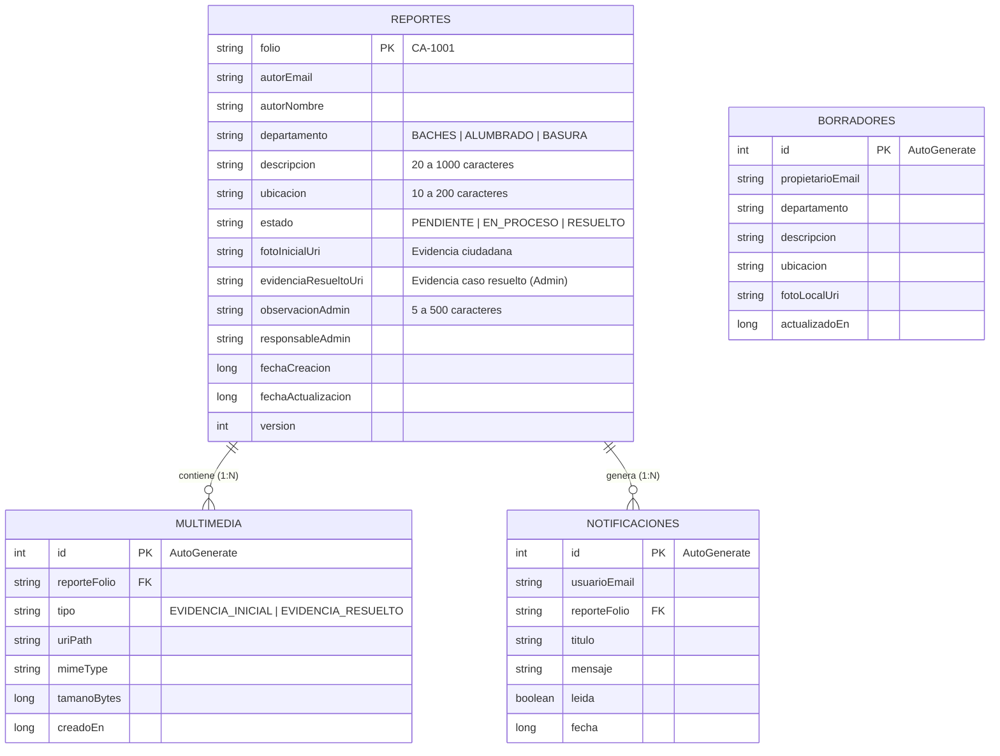
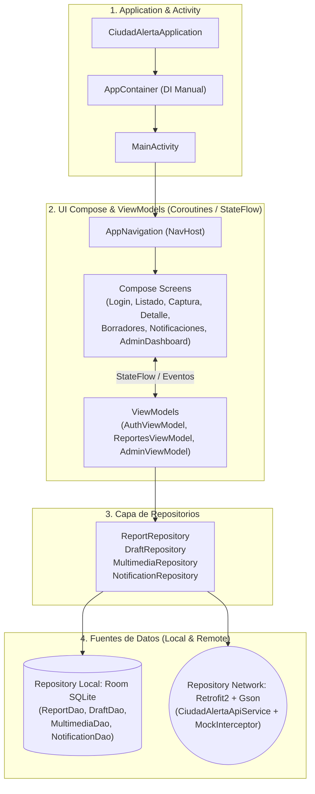
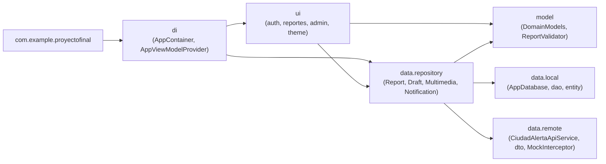
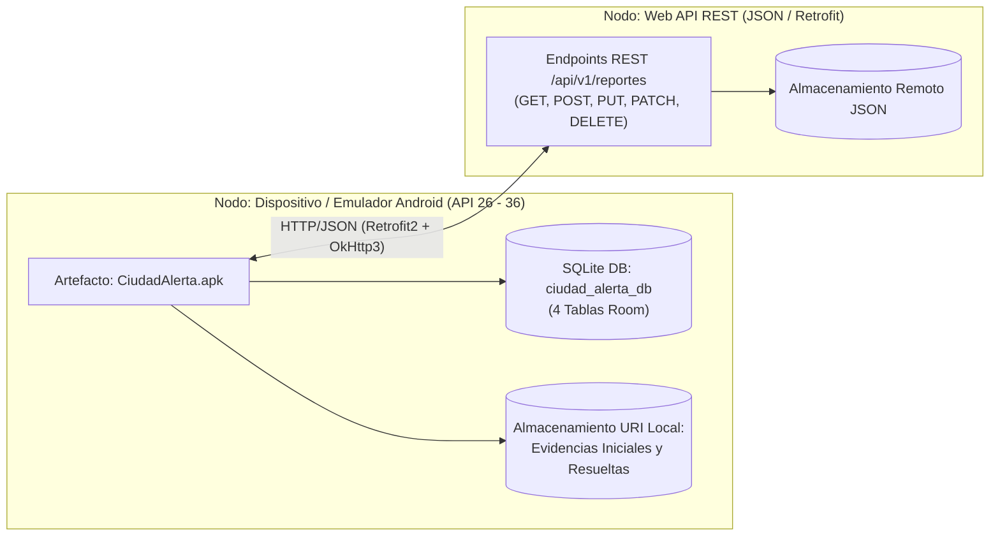
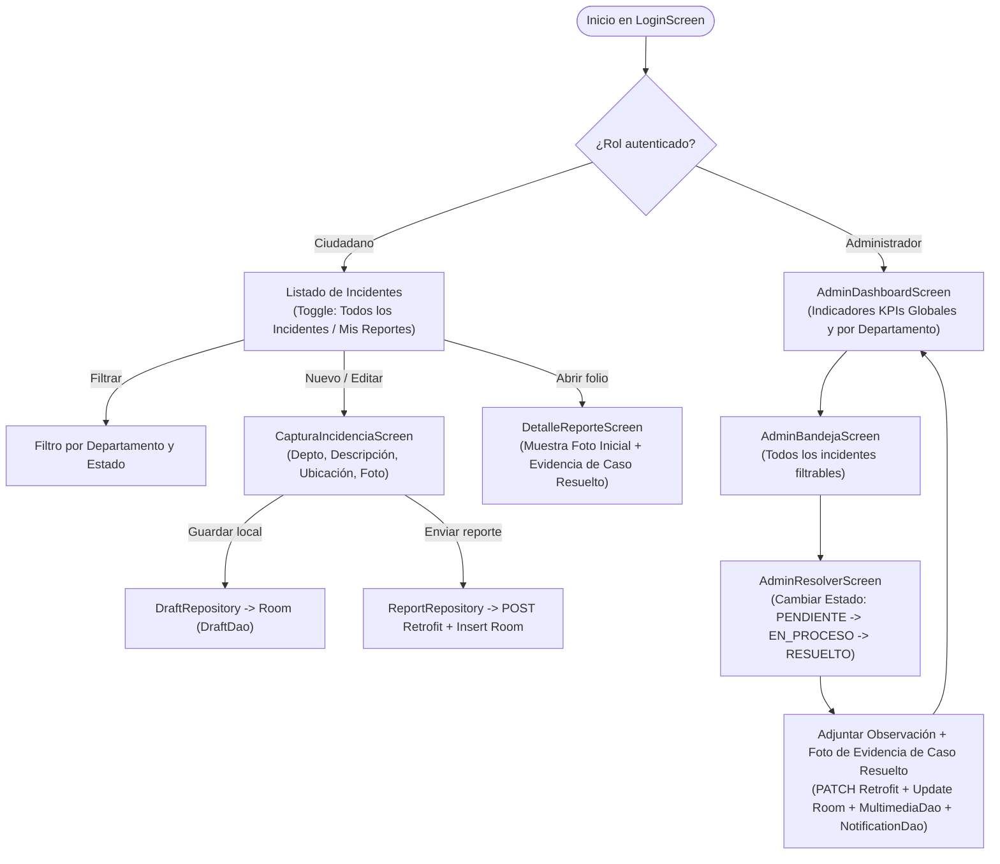

# DOCUMENTO MAESTRO SPEC-DRIVEN DEVELOPMENT (SDD): CIUDAD ALERTA

> **INSTRUCCIÓN DIRECTA PARA EL AGENTE DE IA (CODEX / CURSOR / COPILOT):**
> Este documento es la **Fuente Única de Verdad (Single Source of Truth)** del proyecto Android **Ciudad Alerta**. Contiene la arquitectura obligatoria, las reglas de negocio, los diagramas técnicos y los contratos de código archivo por archivo con sus rutas exactas. Tu objetivo es crear o actualizar los archivos indicados respetando estrictamente los paquetes, nombres de clases, firmas de métodos y flujo de dependencias aquí establecidos.

---

## 1. CONTEXTO, OBJETIVOS Y DECISIONES DE VIABILIDAD ($0 COSTO)

### 1.1 Propósito del Sistema
**Ciudad Alerta** es una aplicación móvil nativa para Android desarrollada en **Kotlin** con **Jetpack Compose** que permite a los ciudadanos reportar incidencias comunitarias no urgentes (baches, fallas de alumbrado público y acumulación de basura), almacenar borradores locales, consultar todos los incidentes de la comunidad o los propios, recibir notificaciones de seguimiento y permitir a un **Administrador** visualizar un Dashboard con indicadores por departamento y resolver casos adjuntando observación y evidencia fotográfica de caso resuelto.

### 1.2 Criterios Técnicos Obligatorios (Rúbrica de Evaluación)
1. **Cadena de Inyección de Dependencias Manual Estricta:**
   `CiudadAlertaApplication -> MainActivity -> Compose (AppNavigation + Screens) -> ViewModel -> Repository -> Repository Local (SQLite Room) / Repository Remote (Retrofit)`
2. **Base de Datos Local (Room SQLite):**
   - Implementación completa de Entidades, DAOs y `@Database`.
   - Transacciones CRUD completas (`Agregar`, `Editar`, `Ver`, `Eliminar`, `Listar`).
   - Modelos y DAOs listos y operativos para **Reportes**, **Borradores**, **Notificaciones** y **Multimedia**.
3. **Interacción con Web APIs (Retrofit + JSON):**
   - Consumo de Web API mediante `Retrofit2` + `Gson` + `OkHttp3`.
   - Operaciones completas (`Agregar`, `Editar`, `Ver`, `Eliminar`, `Listar`, `Recuperar`).
   - **Solución Costo $0 (Autónoma para Revisión):** Se incluye un `MockNetworkInterceptor` en `OkHttpClient` que intercepta las llamadas hacia `https://api.ciudadalerta.local/api/v1/` y responde con payloads JSON HTTP 200/201 reales en memoria. Esto garantiza que Retrofit serialice y deserialice JSON reales sin depender de servidores externos de pago ni cuentas de facturación (reemplazando Firebase Blaze por Retrofit).
4. **100% de UI Definida (Compose + ViewModel) y Navegación Concluida (`NavHost`):**
   - Todas las pantallas conectadas con sus respectivos `ViewModel` usando **Coroutines (`viewModelScope`)** y `StateFlow`.
   - **Cliente (Ciudadano):** Puede ver **todos los incidentes de la comunidad** o filtrar solo **sus reportes**, filtrar por departamento y estado, crear/editar/eliminar reportes y borradores, y ver la **evidencia de caso resuelto**.
   - **Administrador:** Cuenta con **Dashboard con indicadores por departamentos**, bandeja administrativa y pantalla para actualizar estado (`PENDIENTE -> EN_PROCESO -> RESUELTO`) adjuntando **evidencia fotográfica de caso resuelto**.

---

## 2. MAPA DE ARCHIVOS DEL PROYECTO (ESTRUCTURA EXACTA)

El agente debe crear o mantener la siguiente estructura de directorios bajo `app/src/main/`:

```text
app/
├── build.gradle.kts
└── src/main/
    ├── AndroidManifest.xml
    └── java/com/example/proyectofinal/
        ├── CiudadAlertaApplication.kt
        ├── MainActivity.kt
        ├── di/
        │   ├── AppContainer.kt
        │   └── AppViewModelProvider.kt
        ├── model/
        │   └── DomainModels.kt
        ├── data/
        │   ├── local/
        │   │   ├── AppDatabase.kt
        │   │   ├── entity/
        │   │   │   ├── ReportEntity.kt
        │   │   │   ├── DraftEntity.kt
        │   │   │   ├── MultimediaEntity.kt
        │   │   │   └── NotificationEntity.kt
        │   │   └── dao/
        │   │       ├── ReportDao.kt
        │   │       ├── DraftDao.kt
        │   │       ├── MultimediaDao.kt
        │   │       └── NotificationDao.kt
        │   ├── remote/
        │   │   ├── CiudadAlertaApiService.kt
        │   │   ├── MockNetworkInterceptor.kt
        │   │   └── dto/
        │   │       └── NetworkDtos.kt
        │   └── repository/
        │       ├── ReportRepository.kt
        │       ├── DraftRepository.kt
        │       ├── MultimediaRepository.kt
        │       └── NotificationRepository.kt
        └── ui/
            ├── AppNavigation.kt
            ├── auth/
            │   ├── AuthViewModel.kt
            │   ├── LoginScreen.kt
            │   ├── RegisterScreen.kt
            │   └── RecoveryScreen.kt
            ├── reportes/
            │   ├── ReportesViewModel.kt
            │   ├── ListadoReportesScreen.kt
            │   ├── CapturaIncidenciaScreen.kt
            │   ├── DetalleReporteScreen.kt
            │   ├── BorradoresScreen.kt
            │   └── NotificacionesScreen.kt
            ├── admin/
            │   ├── AdminViewModel.kt
            │   ├── AdminDashboardScreen.kt
            │   ├── AdminBandejaScreen.kt
            │   └── AdminResolverScreen.kt
            └── theme/
                ├── Color.kt
                ├── Theme.kt
                └── Type.kt
```

---

## 3. CONFIGURACIÓN DE GRADLE Y MANIFEST

### 3.1 Archivo: `gradle/libs.versions.toml`
Asegurar que el catálogo de versiones soporte Room, Retrofit, Navigation Compose y Coroutines, o declararlos directamente en `app/build.gradle.kts`.

### 3.2 Archivo: `app/build.gradle.kts`
```kotlin
plugins {
    alias(libs.plugins.android.application)
    alias(libs.plugins.kotlin.compose)
    id("org.jetbrains.kotlin.kapt")
}

android {
    namespace = "com.example.proyectofinal"
    compileSdk = 36

    defaultConfig {
        applicationId = "com.example.proyectofinal"
        minSdk = 26
        targetSdk = 36
        versionCode = 1
        versionName = "1.0"

        testInstrumentationRunner = "androidx.test.runner.AndroidJUnitRunner"
    }

    buildTypes {
        release {
            isMinifyEnabled = false
            proguardFiles(
                getDefaultProguardFile("proguard-android-optimize.txt"),
                "proguard-rules.pro"
            )
        }
    }
    compileOptions {
        sourceCompatibility = JavaVersion.VERSION_11
        targetCompatibility = JavaVersion.VERSION_11
    }
    buildFeatures {
        compose = true
    }
}

dependencies {
    implementation(libs.androidx.core.ktx)
    implementation(libs.androidx.lifecycle.runtime.ktx)
    implementation(libs.androidx.activity.compose)
    implementation(platform(libs.androidx.compose.bom))
    implementation(libs.androidx.compose.ui)
    implementation(libs.androidx.compose.ui.graphics)
    implementation(libs.androidx.compose.ui.tooling.preview)
    implementation(libs.androidx.compose.material3)
    implementation("androidx.compose.material:material-icons-extended")

    // Navigation & ViewModel Compose
    implementation("androidx.navigation:navigation-compose:2.8.5")
    implementation("androidx.lifecycle:lifecycle-viewmodel-compose:2.8.7")
    implementation("androidx.lifecycle:lifecycle-runtime-compose:2.8.7")

    // Room (SQLite Local Repository)
    val roomVersion = "2.6.1"
    implementation("androidx.room:room-runtime:$roomVersion")
    implementation("androidx.room:room-ktx:$roomVersion")
    kapt("androidx.room:room-compiler:$roomVersion")

    // Retrofit + Gson + OkHttp (Remote Web API Repository)
    implementation("com.squareup.retrofit2:retrofit:2.11.0")
    implementation("com.squareup.retrofit2:converter-gson:2.11.0")
    implementation("com.squareup.okhttp3:okhttp:4.12.0")
    implementation("com.squareup.okhttp3:logging-interceptor:4.12.0")

    // Coil (Carga de imágenes y evidencias)
    implementation("io.coil-kt:coil-compose:2.7.0")

    testImplementation(libs.junit)
    androidTestImplementation(libs.androidx.junit)
    androidTestImplementation(libs.androidx.espresso.core)
    androidTestImplementation(platform(libs.androidx.compose.bom))
    androidTestImplementation(libs.androidx.compose.ui.test.junit4)
    debugImplementation(libs.androidx.compose.ui.tooling)
    debugImplementation(libs.androidx.compose.ui.test.manifest)
}
```

### 3.3 Archivo: `app/src/main/AndroidManifest.xml`
Es obligatorio registrar `android:name=".CiudadAlertaApplication"` y el permiso `INTERNET`:
```xml
<?xml version="1.0" encoding="utf-8"?>
<manifest xmlns:android="http://schemas.android.com/apk/res/android"
    xmlns:tools="http://schemas.android.com/tools">

    <uses-permission android:name="android.permission.INTERNET" />

    <application
        android:name=".CiudadAlertaApplication"
        android:allowBackup="true"
        android:dataExtractionRules="@xml/data_extraction_rules"
        android:fullBackupContent="@xml/backup_rules"
        android:icon="@mipmap/ic_launcher"
        android:label="@string/app_name"
        android:roundIcon="@mipmap/ic_launcher_round"
        android:supportsRtl="true"
        android:theme="@style/Theme.ProyectoFinal">
        <activity
            android:name=".MainActivity"
            android:exported="true"
            android:label="@string/app_name"
            android:theme="@style/Theme.ProyectoFinal">
            <intent-filter>
                <action android:name="android.intent.action.MAIN" />
                <category android:name="android.intent.category.LAUNCHER" />
            </intent-filter>
        </activity>
    </application>

</manifest>
```

---

## 4. ESPECIFICACIÓN DE ARCHIVOS BASE POR CAPA

### CAPA 1: MODELOS DE DOMINIO Y REGLAS DE NEGOCIO

#### Archivo: `app/src/main/java/com/example/proyectofinal/model/DomainModels.kt`
```kotlin
package com.example.proyectofinal.model

enum class UserRole(val label: String) {
    CIUDADANO("Ciudadano"),
    ADMIN("Administrador")
}

enum class Department(val code: String, val displayName: String, val departmentArea: String) {
    BACHES("BACHES", "Baches", "Departamento de Obras Públicas"),
    ALUMBRADO("ALUMBRADO", "Alumbrado", "Departamento de Servicios Públicos"),
    BASURA("BASURA", "Basura", "Departamento de Limpia y Recolección");

    companion object {
        fun fromCode(code: String): Department =
            entries.find { it.code.equals(code, ignoreCase = true) || it.displayName.equals(code, ignoreCase = true) }
                ?: BACHES
    }
}

enum class ReportStatus(val code: String, val displayName: String) {
    PENDIENTE("PENDIENTE", "Pendiente"),
    EN_PROCESO("EN_PROCESO", "En proceso"),
    RESUELTO("RESUELTO", "Resuelto");

    companion object {
        fun fromCode(code: String): ReportStatus =
            entries.find { it.code.equals(code, ignoreCase = true) || it.displayName.equals(code, ignoreCase = true) }
                ?: PENDIENTE

        fun canTransition(from: ReportStatus, to: ReportStatus): Boolean {
            return (from == PENDIENTE && to == EN_PROCESO) ||
                   (from == EN_PROCESO && to == RESUELTO)
        }
    }
}

enum class MultimediaType(val code: String) {
    EVIDENCIA_INICIAL("EVIDENCIA_INICIAL"),
    EVIDENCIA_RESUELTO("EVIDENCIA_RESUELTO")
}

data class UserSession(
    val uid: String,
    val email: String,
    val nombre: String,
    val role: UserRole
)

data class DepartmentKpi(
    val department: Department,
    val total: Int,
    val pendientes: Int,
    val enProceso: Int,
    val resueltos: Int
)

object ReportValidator {
    fun validateDescription(desc: String): String? {
        val trimmed = desc.trim()
        return when {
            trimmed.isEmpty() -> "La descripción es obligatoria."
            trimmed.length < 20 -> "Mínimo 20 caracteres (actual: ${trimmed.length})."
            trimmed.length > 1000 -> "Máximo 1000 caracteres."
            else -> null
        }
    }

    fun validateLocation(loc: String): String? {
        val trimmed = loc.trim()
        return when {
            trimmed.isEmpty() -> "La ubicación escrita es obligatoria."
            trimmed.length < 10 -> "Mínimo 10 caracteres (actual: ${trimmed.length})."
            trimmed.length > 200 -> "Máximo 200 caracteres."
            else -> null
        }
    }

    fun validateAdminObservation(obs: String): String? {
        val trimmed = obs.trim()
        return when {
            trimmed.isEmpty() -> "La observación es obligatoria para cambiar el estado."
            trimmed.length < 5 -> "La observación debe tener al menos 5 caracteres."
            trimmed.length > 500 -> "Máximo 500 caracteres."
            else -> null
        }
    }
}
```

---

### CAPA 2: BASE DE DATOS LOCAL (SQLITE - ROOM)

#### Archivo: `app/src/main/java/com/example/proyectofinal/data/local/entity/ReportEntity.kt`
```kotlin
package com.example.proyectofinal.data.local.entity

import androidx.room.Entity
import androidx.room.PrimaryKey

@Entity(tableName = "reportes")
data class ReportEntity(
    @PrimaryKey val folio: String,
    val autorEmail: String,
    val autorNombre: String,
    val departamento: String,          // BACHES | ALUMBRADO | BASURA
    val descripcion: String,           // 20..1000 chars
    val ubicacion: String,             // 10..200 chars
    val estado: String,                // PENDIENTE | EN_PROCESO | RESUELTO
    val fotoInicialUri: String?,       // Evidencia ciudadana
    val evidenciaResueltoUri: String?, // Evidencia cuando el caso es resuelto por Admin
    val observacionAdmin: String?,     // Observación del cambio de estado
    val responsableAdmin: String?,     // Correo del administrador que atendió
    val fechaCreacion: Long,
    val fechaActualizacion: Long,
    val version: Int = 1
)
```

#### Archivo: `app/src/main/java/com/example/proyectofinal/data/local/entity/DraftEntity.kt`
```kotlin
package com.example.proyectofinal.data.local.entity

import androidx.room.Entity
import androidx.room.PrimaryKey

@Entity(tableName = "borradores")
data class DraftEntity(
    @PrimaryKey(autoGenerate = true) val id: Int = 0,
    val propietarioEmail: String,
    val departamento: String,
    val descripcion: String,
    val ubicacion: String,
    val fotoLocalUri: String?,
    val actualizadoEn: Long
)
```

#### Archivo: `app/src/main/java/com/example/proyectofinal/data/local/entity/MultimediaEntity.kt`
```kotlin
package com.example.proyectofinal.data.local.entity

import androidx.room.Entity
import androidx.room.PrimaryKey

@Entity(tableName = "multimedia")
data class MultimediaEntity(
    @PrimaryKey(autoGenerate = true) val id: Int = 0,
    val reporteFolio: String,
    val tipo: String, // EVIDENCIA_INICIAL | EVIDENCIA_RESUELTO
    val uriPath: String,
    val mimeType: String = "image/jpeg",
    val tamanoBytes: Long = 102400L,
    val creadoEn: Long = System.currentTimeMillis()
)
```

#### Archivo: `app/src/main/java/com/example/proyectofinal/data/local/entity/NotificationEntity.kt`
```kotlin
package com.example.proyectofinal.data.local.entity

import androidx.room.Entity
import androidx.room.PrimaryKey

@Entity(tableName = "notificaciones")
data class NotificationEntity(
    @PrimaryKey(autoGenerate = true) val id: Int = 0,
    val usuarioEmail: String,
    val reporteFolio: String,
    val titulo: String,
    val mensaje: String,
    val leida: Boolean = false,
    val fecha: Long = System.currentTimeMillis()
)
```

#### Archivo: `app/src/main/java/com/example/proyectofinal/data/local/dao/ReportDao.kt`
```kotlin
package com.example.proyectofinal.data.local.dao

import androidx.room.*
import com.example.proyectofinal.data.local.entity.ReportEntity
import kotlinx.coroutines.flow.Flow

@Dao
interface ReportDao {
    @Query("SELECT * FROM reportes ORDER BY fechaCreacion DESC")
    fun observeAllReports(): Flow<List<ReportEntity>>

    @Query("SELECT * FROM reportes WHERE autorEmail = :email ORDER BY fechaCreacion DESC")
    fun observeReportsByUser(email: String): Flow<List<ReportEntity>>

    @Query("SELECT * FROM reportes WHERE folio = :folio LIMIT 1")
    suspend fun getReportByFolio(folio: String): ReportEntity?

    @Insert(onConflict = OnConflictStrategy.REPLACE)
    suspend fun insertReport(report: ReportEntity)

    @Insert(onConflict = OnConflictStrategy.REPLACE)
    suspend fun insertAll(reports: List<ReportEntity>)

    @Update
    suspend fun updateReport(report: ReportEntity)

    @Delete
    suspend fun deleteReport(report: ReportEntity)

    @Query("DELETE FROM reportes WHERE folio = :folio")
    suspend fun deleteByFolio(folio: String)

    @Query("SELECT COUNT(*) FROM reportes")
    suspend fun countReports(): Int
}
```

#### Archivo: `app/src/main/java/com/example/proyectofinal/data/local/dao/DraftDao.kt`
```kotlin
package com.example.proyectofinal.data.local.dao

import androidx.room.*
import com.example.proyectofinal.data.local.entity.DraftEntity
import kotlinx.coroutines.flow.Flow

@Dao
interface DraftDao {
    @Query("SELECT * FROM borradores WHERE propietarioEmail = :email ORDER BY actualizadoEn DESC")
    fun observeDraftsByUser(email: String): Flow<List<DraftEntity>>

    @Query("SELECT * FROM borradores WHERE id = :id LIMIT 1")
    suspend fun getDraftById(id: Int): DraftEntity?

    @Insert(onConflict = OnConflictStrategy.REPLACE)
    suspend fun insertDraft(draft: DraftEntity): Long

    @Update
    suspend fun updateDraft(draft: DraftEntity)

    @Delete
    suspend fun deleteDraft(draft: DraftEntity)

    @Query("DELETE FROM borradores WHERE id = :id")
    suspend fun deleteDraftById(id: Int)

    @Query("DELETE FROM borradores WHERE propietarioEmail = :email")
    suspend fun clearDraftsForUser(email: String)
}
```

#### Archivo: `app/src/main/java/com/example/proyectofinal/data/local/dao/MultimediaDao.kt`
```kotlin
package com.example.proyectofinal.data.local.dao

import androidx.room.*
import com.example.proyectofinal.data.local.entity.MultimediaEntity
import kotlinx.coroutines.flow.Flow

@Dao
interface MultimediaDao {
    @Query("SELECT * FROM multimedia WHERE reporteFolio = :folio ORDER BY creadoEn ASC")
    fun observeMultimediaForReport(folio: String): Flow<List<MultimediaEntity>>

    @Query("SELECT * FROM multimedia ORDER BY creadoEn DESC")
    fun observeAllMultimedia(): Flow<List<MultimediaEntity>>

    @Insert(onConflict = OnConflictStrategy.REPLACE)
    suspend fun insertMultimedia(item: MultimediaEntity): Long

    @Update
    suspend fun updateMultimedia(item: MultimediaEntity)

    @Delete
    suspend fun deleteMultimedia(item: MultimediaEntity)

    @Query("DELETE FROM multimedia WHERE reporteFolio = :folio")
    suspend fun deleteByFolio(folio: String)
}
```

#### Archivo: `app/src/main/java/com/example/proyectofinal/data/local/dao/NotificationDao.kt`
```kotlin
package com.example.proyectofinal.data.local.dao

import androidx.room.*
import com.example.proyectofinal.data.local.entity.NotificationEntity
import kotlinx.coroutines.flow.Flow

@Dao
interface NotificationDao {
    @Query("SELECT * FROM notificaciones WHERE usuarioEmail = :email ORDER BY fecha DESC")
    fun observeNotificationsForUser(email: String): Flow<List<NotificationEntity>>

    @Insert(onConflict = OnConflictStrategy.REPLACE)
    suspend fun insertNotification(notification: NotificationEntity): Long

    @Update
    suspend fun updateNotification(notification: NotificationEntity)

    @Query("UPDATE notificaciones SET leida = 1 WHERE id = :id")
    suspend fun markAsRead(id: Int)

    @Query("DELETE FROM notificaciones WHERE id = :id")
    suspend fun deleteNotificationById(id: Int)
}
```

#### Archivo: `app/src/main/java/com/example/proyectofinal/data/local/AppDatabase.kt`
```kotlin
package com.example.proyectofinal.data.local

import android.content.Context
import androidx.room.Database
import androidx.room.Room
import androidx.room.RoomDatabase
import com.example.proyectofinal.data.local.dao.*
import com.example.proyectofinal.data.local.entity.*

@Database(
    entities = [
        ReportEntity::class,
        DraftEntity::class,
        MultimediaEntity::class,
        NotificationEntity::class
    ],
    version = 1,
    exportSchema = false
)
abstract class AppDatabase : RoomDatabase() {
    abstract fun reportDao(): ReportDao
    abstract fun draftDao(): DraftDao
    abstract fun multimediaDao(): MultimediaDao
    abstract fun notificationDao(): NotificationDao

    companion object {
        @Volatile
        private var INSTANCE: AppDatabase? = null

        fun getDatabase(context: Context): AppDatabase {
            return INSTANCE ?: synchronized(this) {
                Room.databaseBuilder(
                    context.applicationContext,
                    AppDatabase::class.java,
                    "ciudad_alerta_db"
                )
                    .fallbackToDestructiveMigration()
                    .build()
                    .also { INSTANCE = it }
            }
        }
    }
}
```

---

### CAPA 3: RED Y WEB API (RETROFIT + JSON + INTERCEPTOR AUTÓNOMO)

#### Archivo: `app/src/main/java/com/example/proyectofinal/data/remote/dto/NetworkDtos.kt`
```kotlin
package com.example.proyectofinal.data.remote.dto

import com.example.proyectofinal.data.local.entity.ReportEntity
import com.google.gson.annotations.SerializedName

data class ReportDto(
    @SerializedName("folio") val folio: String,
    @SerializedName("autorEmail") val autorEmail: String,
    @SerializedName("autorNombre") val autorNombre: String,
    @SerializedName("departamento") val departamento: String,
    @SerializedName("descripcion") val descripcion: String,
    @SerializedName("ubicacion") val ubicacion: String,
    @SerializedName("estado") val estado: String,
    @SerializedName("fotoInicialUri") val fotoInicialUri: String?,
    @SerializedName("evidenciaResueltoUri") val evidenciaResueltoUri: String?,
    @SerializedName("observacionAdmin") val observacionAdmin: String?,
    @SerializedName("responsableAdmin") val responsableAdmin: String?,
    @SerializedName("fechaCreacion") val fechaCreacion: Long,
    @SerializedName("fechaActualizacion") val fechaActualizacion: Long,
    @SerializedName("version") val version: Int = 1
)

data class StatusUpdateDto(
    @SerializedName("estadoNuevo") val estadoNuevo: String,
    @SerializedName("observacionAdmin") val observacionAdmin: String,
    @SerializedName("evidenciaResueltoUri") val evidenciaResueltoUri: String?,
    @SerializedName("responsableAdmin") val responsableAdmin: String,
    @SerializedName("fechaActualizacion") val fechaActualizacion: Long = System.currentTimeMillis()
)

fun ReportDto.toEntity(): ReportEntity = ReportEntity(
    folio = folio,
    autorEmail = autorEmail,
    autorNombre = autorNombre,
    departamento = departamento,
    descripcion = descripcion,
    ubicacion = ubicacion,
    estado = estado,
    fotoInicialUri = fotoInicialUri,
    evidenciaResueltoUri = evidenciaResueltoUri,
    observacionAdmin = observacionAdmin,
    responsableAdmin = responsableAdmin,
    fechaCreacion = fechaCreacion,
    fechaActualizacion = fechaActualizacion,
    version = version
)

fun ReportEntity.toDto(): ReportDto = ReportDto(
    folio = folio,
    autorEmail = autorEmail,
    autorNombre = autorNombre,
    departamento = departamento,
    descripcion = descripcion,
    ubicacion = ubicacion,
    estado = estado,
    fotoInicialUri = fotoInicialUri,
    evidenciaResueltoUri = evidenciaResueltoUri,
    observacionAdmin = observacionAdmin,
    responsableAdmin = responsableAdmin,
    fechaCreacion = fechaCreacion,
    fechaActualizacion = fechaActualizacion,
    version = version
)
```

#### Archivo: `app/src/main/java/com/example/proyectofinal/data/remote/CiudadAlertaApiService.kt`
```kotlin
package com.example.proyectofinal.data.remote

import com.example.proyectofinal.data.remote.dto.ReportDto
import com.example.proyectofinal.data.remote.dto.StatusUpdateDto
import retrofit2.Response
import retrofit2.http.*

interface CiudadAlertaApiService {
    @GET("api/v1/reportes")
    suspend fun listarReportes(): Response<List<ReportDto>>

    @GET("api/v1/reportes/{folio}")
    suspend fun recuperarReporte(@Path("folio") folio: String): Response<ReportDto>

    @POST("api/v1/reportes")
    suspend fun agregarReporte(@Body reporte: ReportDto): Response<ReportDto>

    @PUT("api/v1/reportes/{folio}")
    suspend fun editarReporte(
        @Path("folio") folio: String,
        @Body reporte: ReportDto
    ): Response<ReportDto>

    @PATCH("api/v1/reportes/{folio}/estado")
    suspend fun actualizarEstado(
        @Path("folio") folio: String,
        @Body statusUpdate: StatusUpdateDto
    ): Response<ReportDto>

    @DELETE("api/v1/reportes/{folio}")
    suspend fun eliminarReporte(@Path("folio") folio: String): Response<Unit>
}
```

#### Archivo: `app/src/main/java/com/example/proyectofinal/data/remote/MockNetworkInterceptor.kt`
Interceptor OkHttp que simula un backend REST JSON completo en memoria con datos semilla para todos los departamentos (`BACHES`, `ALUMBRADO`, `BASURA`) y estados (`PENDIENTE`, `EN_PROCESO`, `RESUELTO`):
```kotlin
package com.example.proyectofinal.data.remote

import com.example.proyectofinal.data.remote.dto.ReportDto
import com.example.proyectofinal.data.remote.dto.StatusUpdateDto
import com.google.gson.Gson
import okhttp3.*
import okhttp3.MediaType.Companion.toMediaTypeOrNull
import okhttp3.ResponseBody.Companion.toResponseBody
import okio.Buffer

class MockNetworkInterceptor : Interceptor {
    private val gson = Gson()
    private val now = System.currentTimeMillis()

    private val remoteStorage = mutableListOf(
        ReportDto(
            folio = "CA-1001",
            autorEmail = "ciudadano@comunidad.mx",
            autorNombre = "Juan Ciudadano",
            departamento = "BACHES",
            descripcion = "Bache profundo de más de un metro que obstruye el carril derecho y daña llantas.",
            ubicacion = "Av. Insurgentes esquina con Calle Hidalgo #142",
            estado = "PENDIENTE",
            fotoInicialUri = "https://picsum.photos/seed/bache1/600/400",
            evidenciaResueltoUri = null,
            observacionAdmin = "Reporte recibido en bandeja de Obras Públicas.",
            responsableAdmin = null,
            fechaCreacion = now - 86_400_000L * 3,
            fechaActualizacion = now - 86_400_000L * 3,
            version = 1
        ),
        ReportDto(
            folio = "CA-1002",
            autorEmail = "vecina@comunidad.mx",
            autorNombre = "María López",
            departamento = "ALUMBRADO",
            descripcion = "Tres luminarias apagadas frente al parque comunitario dejando la acera totalmente oscura.",
            ubicacion = "Calle Juárez frente al Parque Central #45",
            estado = "EN_PROCESO",
            fotoInicialUri = "https://picsum.photos/seed/luz2/600/400",
            evidenciaResueltoUri = null,
            observacionAdmin = "Cuadrilla eléctrica asignada con folio interno #EL-88.",
            responsableAdmin = "admin@ciudadalerta.mx",
            fechaCreacion = now - 86_400_000L * 2,
            fechaActualizacion = now - 86_400_000L,
            version = 2
        ),
        ReportDto(
            folio = "CA-1003",
            autorEmail = "ciudadano@comunidad.mx",
            autorNombre = "Juan Ciudadano",
            departamento = "BASURA",
            descripcion = "Acumulación de bolsas de basura y ramas en la esquina por falta de recolección.",
            ubicacion = "Calle Morelos #310 esquina con Allende",
            estado = "RESUELTO",
            fotoInicialUri = "https://picsum.photos/seed/basura1/600/400",
            evidenciaResueltoUri = "https://picsum.photos/seed/limpio3/600/400",
            observacionAdmin = "Camión recolector unidad #12 retiró los desechos y lavó la banqueta.",
            responsableAdmin = "admin@ciudadalerta.mx",
            fechaCreacion = now - 86_400_000L * 5,
            fechaActualizacion = now - 3_600_000L * 5,
            version = 3
        )
    )

    override fun intercept(chain: Interceptor.Chain): Response {
        val request = chain.request()
        val path = request.url.encodedPath
        val method = request.method

        val responseJson: String
        var statusCode = 200

        synchronized(remoteStorage) {
            when {
                method == "GET" && path.endsWith("/reportes") -> {
                    responseJson = gson.toJson(remoteStorage)
                }
                method == "GET" && path.contains("/reportes/") -> {
                    val folio = path.substringAfterLast("/")
                    val found = remoteStorage.find { it.folio == folio }
                    if (found != null) {
                        responseJson = gson.toJson(found)
                    } else {
                        statusCode = 404
                        responseJson = """{"error":"Reporte no encontrado"}"""
                    }
                }
                method == "POST" && path.endsWith("/reportes") -> {
                    val bodyStr = request.bodyToString()
                    val incoming = gson.fromJson(bodyStr, ReportDto::class.java)
                    remoteStorage.removeAll { it.folio == incoming.folio }
                    remoteStorage.add(0, incoming)
                    statusCode = 201
                    responseJson = gson.toJson(incoming)
                }
                method == "PUT" && path.contains("/reportes/") -> {
                    val folio = path.substringAfterLast("/")
                    val bodyStr = request.bodyToString()
                    val updated = gson.fromJson(bodyStr, ReportDto::class.java)
                    val index = remoteStorage.indexOfFirst { it.folio == folio }
                    if (index != -1) {
                        remoteStorage[index] = updated
                    } else {
                        remoteStorage.add(0, updated)
                    }
                    responseJson = gson.toJson(updated)
                }
                method == "PATCH" && path.endsWith("/estado") -> {
                    val segments = path.split("/")
                    val folio = segments[segments.size - 2]
                    val bodyStr = request.bodyToString()
                    val patch = gson.fromJson(bodyStr, StatusUpdateDto::class.java)
                    val index = remoteStorage.indexOfFirst { it.folio == folio }
                    if (index != -1) {
                        val current = remoteStorage[index]
                        val updated = current.copy(
                            estado = patch.estadoNuevo,
                            observacionAdmin = patch.observacionAdmin,
                            evidenciaResueltoUri = patch.evidenciaResueltoUri ?: current.evidenciaResueltoUri,
                            responsableAdmin = patch.responsableAdmin,
                            fechaActualizacion = patch.fechaActualizacion,
                            version = current.version + 1
                        )
                        remoteStorage[index] = updated
                        responseJson = gson.toJson(updated)
                    } else {
                        statusCode = 404
                        responseJson = """{"error":"Reporte no encontrado"}"""
                    }
                }
                method == "DELETE" && path.contains("/reportes/") -> {
                    val folio = path.substringAfterLast("/")
                    remoteStorage.removeAll { it.folio == folio }
                    responseJson = ""
                }
                else -> {
                    responseJson = "[]"
                }
            }
        }

        return Response.Builder()
            .code(statusCode)
            .message("OK")
            .request(request)
            .protocol(Protocol.HTTP_1_1)
            .body(responseJson.toResponseBody("application/json".toMediaTypeOrNull()))
            .addHeader("content-type", "application/json")
            .build()
    }

    private fun Request.bodyToString(): String {
        val buffer = Buffer()
        body?.writeTo(buffer)
        return buffer.readUtf8()
    }
}
```

---

### CAPA 4: REPOSITORIOS (CONEXIÓN ROOM + RETROFIT)

#### Archivo: `app/src/main/java/com/example/proyectofinal/data/repository/ReportRepository.kt`
```kotlin
package com.example.proyectofinal.data.repository

import com.example.proyectofinal.data.local.dao.MultimediaDao
import com.example.proyectofinal.data.local.dao.NotificationDao
import com.example.proyectofinal.data.local.dao.ReportDao
import com.example.proyectofinal.data.local.entity.MultimediaEntity
import com.example.proyectofinal.data.local.entity.NotificationEntity
import com.example.proyectofinal.data.local.entity.ReportEntity
import com.example.proyectofinal.data.remote.CiudadAlertaApiService
import com.example.proyectofinal.data.remote.dto.StatusUpdateDto
import com.example.proyectofinal.data.remote.dto.toDto
import com.example.proyectofinal.data.remote.dto.toEntity
import com.example.proyectofinal.model.MultimediaType
import kotlinx.coroutines.flow.Flow

class ReportRepository(
    private val reportDao: ReportDao,
    private val multimediaDao: MultimediaDao,
    private val notificationDao: NotificationDao,
    private val apiService: CiudadAlertaApiService
) {
    fun observeAllReports(): Flow<List<ReportEntity>> = reportDao.observeAllReports()

    fun observeReportsByUser(email: String): Flow<List<ReportEntity>> =
        reportDao.observeReportsByUser(email)

    suspend fun getReportByFolio(folio: String): ReportEntity? {
        val local = reportDao.getReportByFolio(folio)
        if (local != null) return local
        val remote = apiService.recuperarReporte(folio)
        if (remote.isSuccessful) {
            remote.body()?.let { dto ->
                val entity = dto.toEntity()
                reportDao.insertReport(entity)
                return entity
            }
        }
        return null
    }

    suspend fun syncWithRemote(): Result<Unit> = runCatching {
        val response = apiService.listarReportes()
        if (response.isSuccessful) {
            val entities = response.body().orEmpty().map { it.toEntity() }
            reportDao.insertAll(entities)
            entities.forEach { rep ->
                rep.fotoInicialUri?.let { uri ->
                    multimediaDao.insertMultimedia(
                        MultimediaEntity(
                            reporteFolio = rep.folio,
                            tipo = MultimediaType.EVIDENCIA_INICIAL.code,
                            uriPath = uri
                        )
                    )
                }
                rep.evidenciaResueltoUri?.let { uri ->
                    multimediaDao.insertMultimedia(
                        MultimediaEntity(
                            reporteFolio = rep.folio,
                            tipo = MultimediaType.EVIDENCIA_RESUELTO.code,
                            uriPath = uri
                        )
                    )
                }
            }
        }
    }

    suspend fun createReport(report: ReportEntity): Result<ReportEntity> = runCatching {
        val response = apiService.agregarReporte(report.toDto())
        val confirmed = if (response.isSuccessful && response.body() != null) {
            response.body()!!.toEntity()
        } else {
            report
        }
        reportDao.insertReport(confirmed)

        confirmed.fotoInicialUri?.let { uri ->
            multimediaDao.insertMultimedia(
                MultimediaEntity(
                    reporteFolio = confirmed.folio,
                    tipo = MultimediaType.EVIDENCIA_INICIAL.code,
                    uriPath = uri
                )
            )
        }

        notificationDao.insertNotification(
            NotificationEntity(
                usuarioEmail = confirmed.autorEmail,
                reporteFolio = confirmed.folio,
                titulo = "Reporte registrado (${confirmed.folio})",
                mensaje = "Tu reporte en ${confirmed.departamento} fue recibido con estado PENDIENTE."
            )
        )
        confirmed
    }

    suspend fun updateReport(report: ReportEntity): Result<ReportEntity> = runCatching {
        val updated = report.copy(fechaActualizacion = System.currentTimeMillis())
        apiService.editarReporte(updated.folio, updated.toDto())
        reportDao.updateReport(updated)
        updated
    }

    suspend fun updateReportStatusByAdmin(
        folio: String,
        nuevoEstado: String,
        observacion: String,
        evidenciaResueltoUri: String?,
        adminEmail: String
    ): Result<ReportEntity> = runCatching {
        val existing = reportDao.getReportByFolio(folio)
            ?: throw IllegalStateException("No existe el reporte $folio")

        val dto = StatusUpdateDto(
            estadoNuevo = nuevoEstado,
            observacionAdmin = observacion,
            evidenciaResueltoUri = evidenciaResueltoUri,
            responsableAdmin = adminEmail
        )
        val response = apiService.actualizarEstado(folio, dto)
        val updatedEntity = if (response.isSuccessful && response.body() != null) {
            response.body()!!.toEntity()
        } else {
            existing.copy(
                estado = nuevoEstado,
                observacionAdmin = observacion,
                evidenciaResueltoUri = evidenciaResueltoUri ?: existing.evidenciaResueltoUri,
                responsableAdmin = adminEmail,
                fechaActualizacion = System.currentTimeMillis(),
                version = existing.version + 1
            )
        }

        reportDao.updateReport(updatedEntity)

        if (!evidenciaResueltoUri.isNullOrBlank()) {
            multimediaDao.insertMultimedia(
                MultimediaEntity(
                    reporteFolio = folio,
                    tipo = MultimediaType.EVIDENCIA_RESUELTO.code,
                    uriPath = evidenciaResueltoUri
                )
            )
        }

        notificationDao.insertNotification(
            NotificationEntity(
                usuarioEmail = updatedEntity.autorEmail,
                reporteFolio = folio,
                titulo = "Actualización de folio $folio: $nuevoEstado",
                mensaje = "Observación de administración: $observacion"
            )
        )

        updatedEntity
    }

    suspend fun deleteReport(folio: String): Result<Unit> = runCatching {
        apiService.eliminarReporte(folio)
        multimediaDao.deleteByFolio(folio)
        reportDao.deleteByFolio(folio)
    }
}
```

#### Archivo: `app/src/main/java/com/example/proyectofinal/data/repository/DraftRepository.kt`
```kotlin
package com.example.proyectofinal.data.repository

import com.example.proyectofinal.data.local.dao.DraftDao
import com.example.proyectofinal.data.local.entity.DraftEntity
import kotlinx.coroutines.flow.Flow

class DraftRepository(private val draftDao: DraftDao) {
    fun observeDraftsByUser(email: String): Flow<List<DraftEntity>> =
        draftDao.observeDraftsByUser(email)

    suspend fun getDraftById(id: Int): DraftEntity? = draftDao.getDraftById(id)

    suspend fun saveDraft(draft: DraftEntity): Long = draftDao.insertDraft(draft)

    suspend fun updateDraft(draft: DraftEntity) = draftDao.updateDraft(draft)

    suspend fun deleteDraft(id: Int) = draftDao.deleteDraftById(id)

    suspend fun clearUserDrafts(email: String) = draftDao.clearDraftsForUser(email)
}
```

#### Archivo: `app/src/main/java/com/example/proyectofinal/data/repository/MultimediaRepository.kt`
```kotlin
package com.example.proyectofinal.data.repository

import com.example.proyectofinal.data.local.dao.MultimediaDao
import com.example.proyectofinal.data.local.entity.MultimediaEntity
import kotlinx.coroutines.flow.Flow

class MultimediaRepository(private val multimediaDao: MultimediaDao) {
    fun observeMultimediaForReport(folio: String): Flow<List<MultimediaEntity>> =
        multimediaDao.observeMultimediaForReport(folio)

    suspend fun addMultimedia(entity: MultimediaEntity): Long =
        multimediaDao.insertMultimedia(entity)
}
```

#### Archivo: `app/src/main/java/com/example/proyectofinal/data/repository/NotificationRepository.kt`
```kotlin
package com.example.proyectofinal.data.repository

import com.example.proyectofinal.data.local.dao.NotificationDao
import com.example.proyectofinal.data.local.entity.NotificationEntity
import kotlinx.coroutines.flow.Flow

class NotificationRepository(private val notificationDao: NotificationDao) {
    fun observeNotifications(email: String): Flow<List<NotificationEntity>> =
        notificationDao.observeNotificationsForUser(email)

    suspend fun markAsRead(id: Int) = notificationDao.markAsRead(id)

    suspend fun deleteNotification(id: Int) = notificationDao.deleteNotificationById(id)
}
```

---

### CAPA 5: INYECCIÓN DE DEPENDENCIAS (`Application -> Activity -> Compose -> ViewModel -> Repository`)

#### Archivo: `app/src/main/java/com/example/proyectofinal/di/AppContainer.kt`
```kotlin
package com.example.proyectofinal.di

import android.content.Context
import com.example.proyectofinal.data.local.AppDatabase
import com.example.proyectofinal.data.remote.CiudadAlertaApiService
import com.example.proyectofinal.data.remote.MockNetworkInterceptor
import com.example.proyectofinal.data.repository.DraftRepository
import com.example.proyectofinal.data.repository.MultimediaRepository
import com.example.proyectofinal.data.repository.NotificationRepository
import com.example.proyectofinal.data.repository.ReportRepository
import okhttp3.OkHttpClient
import okhttp3.logging.HttpLoggingInterceptor
import retrofit2.Retrofit
import retrofit2.converter.gson.GsonConverterFactory

class AppContainer(context: Context) {
    private val database: AppDatabase by lazy {
        AppDatabase.getDatabase(context)
    }

    private val okHttpClient: OkHttpClient by lazy {
        val logging = HttpLoggingInterceptor().apply {
            level = HttpLoggingInterceptor.Level.BODY
        }
        OkHttpClient.Builder()
            .addInterceptor(logging)
            .addInterceptor(MockNetworkInterceptor())
            .build()
    }

    private val retrofit: Retrofit by lazy {
        Retrofit.Builder()
            .baseUrl("https://api.ciudadalerta.local/")
            .client(okHttpClient)
            .addConverterFactory(GsonConverterFactory.create())
            .build()
    }

    val apiService: CiudadAlertaApiService by lazy {
        retrofit.create(CiudadAlertaApiService::class.java)
    }

    val reportRepository: ReportRepository by lazy {
        ReportRepository(
            reportDao = database.reportDao(),
            multimediaDao = database.multimediaDao(),
            notificationDao = database.notificationDao(),
            apiService = apiService
        )
    }

    val draftRepository: DraftRepository by lazy {
        DraftRepository(database.draftDao())
    }

    val multimediaRepository: MultimediaRepository by lazy {
        MultimediaRepository(database.multimediaDao())
    }

    val notificationRepository: NotificationRepository by lazy {
        NotificationRepository(database.notificationDao())
    }
}
```

#### Archivo: `app/src/main/java/com/example/proyectofinal/CiudadAlertaApplication.kt`
```kotlin
package com.example.proyectofinal

import android.app.Application
import com.example.proyectofinal.di.AppContainer

class CiudadAlertaApplication : Application() {
    lateinit var container: AppContainer
        private set

    override fun onCreate() {
        super.onCreate()
        container = AppContainer(this)
    }
}
```

#### Archivo: `app/src/main/java/com/example/proyectofinal/di/AppViewModelProvider.kt`
```kotlin
package com.example.proyectofinal.di

import androidx.lifecycle.ViewModelProvider
import androidx.lifecycle.viewmodel.CreationExtras
import androidx.lifecycle.viewmodel.initializer
import androidx.lifecycle.viewmodel.viewModelFactory
import com.example.proyectofinal.CiudadAlertaApplication
import com.example.proyectofinal.ui.admin.AdminViewModel
import com.example.proyectofinal.ui.auth.AuthViewModel
import com.example.proyectofinal.ui.reportes.ReportesViewModel

object AppViewModelProvider {
    val Factory = viewModelFactory {
        initializer {
            AuthViewModel(ciudadAlertaApplication().container.draftRepository)
        }
        initializer {
            val container = ciudadAlertaApplication().container
            ReportesViewModel(
                reportRepository = container.reportRepository,
                draftRepository = container.draftRepository,
                multimediaRepository = container.multimediaRepository,
                notificationRepository = container.notificationRepository
            )
        }
        initializer {
            val container = ciudadAlertaApplication().container
            AdminViewModel(
                reportRepository = container.reportRepository,
                multimediaRepository = container.multimediaRepository
            )
        }
    }
}

fun CreationExtras.ciudadAlertaApplication(): CiudadAlertaApplication =
    (this[ViewModelProvider.AndroidViewModelFactory.APPLICATION_KEY] as CiudadAlertaApplication)
```

---

### CAPA 6: VIEWMODELS Y MANEJO DE COROUTINES (`StateFlow`)

#### Archivo: `app/src/main/java/com/example/proyectofinal/ui/auth/AuthViewModel.kt`
- Maneja el inicio de sesión de **Ciudadano** y **Administrador**, registro de cuentas ciudadanas, restablecimiento de contraseña y cierre de sesión limpiando borradores locales (`draftRepository.clearUserDrafts`).
- Incluye métodos rápidos `loginDemoCiudadano()` (`ciudadano@comunidad.mx`) y `loginDemoAdmin()` (`admin@ciudadalerta.mx`) para agilizar la revisión presencial.

#### Archivo: `app/src/main/java/com/example/proyectofinal/ui/reportes/ReportesViewModel.kt`
- Expone `StateFlow<ReportesUiState>` combinando:
  - `allReports`: Todos los reportes de la comunidad sincronizados entre Room y Retrofit.
  - `showOnlyMyReports`: Booleano para alternar entre **"Todos los incidentes (Comunidad)"** y **"Mis Reportes"**.
  - `selectedDepartment`: Filtro por `BACHES`, `ALUMBRADO`, `BASURA` o ` null` (Todos).
  - `selectedStatus`: Filtro por `PENDIENTE`, `EN_PROCESO`, `RESUELTO` o `null` (Todos).
  - `drafts`: Lista reactiva de borradores en Room (`DraftEntity`).
  - `notifications`: Lista reactiva de avisos en Room (`NotificationEntity`).
- Operaciones con Coroutines (`viewModelScope.launch`):
  - `syncRemoteReports()`
  - `crearOEditarReporte(...)`
  - `eliminarReporte(folio)`
  - `guardarBorrador(...)` y `eliminarBorrador(id)`
  - `marcarNotificacionLeida(id)`

#### Archivo: `app/src/main/java/com/example/proyectofinal/ui/admin/AdminViewModel.kt`
- Expone `StateFlow<AdminUiState>` con:
  - **KPIs Globales:** Total de reportes, total pendientes, total en proceso, total resueltos y porcentaje de atención.
  - **Indicadores por Departamento (`List<DepartmentKpi>`):** Calcula automáticamente cuántos incidentes tiene cada departamento (`Obras Públicas - Baches`, `Servicios Públicos - Alumbrado`, `Limpia - Basura`) y su desglose por estado.
  - Método `resolverOCambiarEstado(folio, nuevoEstado, observacion, evidenciaResueltoUri, adminEmail)` que valida la transición lineal (`PENDIENTE -> EN_PROCESO -> RESUELTO`), exige observación de 5 a 500 caracteres y guarda la **Evidencia Fotográfica de Caso Resuelto** tanto en `ReportEntity` como en `MultimediaEntity`.

---

### CAPA 7: PANTALLAS JETPACK COMPOSE Y NAVEGACIÓN (`NavHost`)

#### Archivo: `app/src/main/java/com/example/proyectofinal/ui/AppNavigation.kt`
Define el `NavHost` completo con las siguientes rutas:
1. `"login"` -> `LoginScreen`
2. `"register"` -> `RegisterScreen`
3. `"recovery"` -> `RecoveryScreen`
4. `"listado_reportes"` -> `ListadoReportesScreen` (Vista del Cliente: Ver todos los incidentes / Mis reportes, filtros por departamento/estado, botones para ir a Borradores, Notificaciones, Detalle, Editar y Eliminar).
5. `"captura_incidencia?folio={folio}&draftId={draftId}"` -> `CapturaIncidenciaScreen` (Formulario validado para crear/editar reporte o guardar borrador en Room + selector de fotografía con `PickVisualMedia`).
6. `"borradores"` -> `BorradoresScreen` (Listado de borradores locales en Room con acciones para retomar, enviar o eliminar).
7. `"notificaciones"` -> `NotificacionesScreen` (Historial de notificaciones en Room generadas por cambios de estado).
8. `"detalle_reporte/{folio}"` -> `DetalleReporteScreen` (Expediente completo del incidente: muestra foto inicial, estado, departamento, observación del administrador y la **Evidencia de Caso Resuelto** cuando el reporte fue solucionado).
9. `"admin_dashboard"` -> `AdminDashboardScreen` (Dashboard administrativo con tarjetas de indicadores generales y gráficos/barras de indicadores desglosados por departamento).
10. `"admin_bandeja"` -> `AdminBandejaScreen` (Bandeja administrativa con filtros por departamento y estado para gestionar todos los incidentes de la comunidad).
11. `"admin_resolver/{folio}"` -> `AdminResolverScreen` (Pantalla para cambiar estado a `EN_PROCESO` o `RESUELTO`, capturar observación obligatoria y adjuntar la fotografía de **Evidencia de Caso Resuelto**).

---

## 5. DIAGRAMAS DE ARQUITECTURA, BASE DE DATOS Y FLUJO (PARA REVISIÓN ACADÉMICA)

### 5.1 Diagrama de Base de Datos (Entidad-Relación Room SQLite)


### 5.2 Diagrama UML de Componentes y Cadena de Dependencias


### 5.3 Diagrama UML de Paquetes


### 5.4 Diagrama UML de Despliegue


### 5.5 Diagrama de Flujo de Negocio (Ciudadano y Administrador)


---

## 6. PLAN DE EJECUCIÓN PASO A PASO PARA EL AGENTE (TASK BREAKDOWN)

Cuando el agente ejecute este documento, debe seguir este orden secuencial para garantizar que el proyecto compile sin errores en cada etapa:

- **Fase 1 (Configuración y Dominio):**
  1. Actualizar `app/build.gradle.kts` con Room (`kapt`), Retrofit, Gson, OkHttp, Coil y Navigation Compose.
  2. Crear `model/DomainModels.kt`.
- **Fase 2 (Persistencia Local Room):**
  3. Crear las 4 entidades en `data/local/entity/` (`ReportEntity`, `DraftEntity`, `MultimediaEntity`, `NotificationEntity`).
  4. Crear los 4 DAOs en `data/local/dao/` (`ReportDao`, `DraftDao`, `MultimediaDao`, `NotificationDao`).
  5. Crear `data/local/AppDatabase.kt`.
- **Fase 3 (Red Retrofit y Repositorios):**
  6. Crear `data/remote/dto/NetworkDtos.kt`, `data/remote/CiudadAlertaApiService.kt` y `data/remote/MockNetworkInterceptor.kt`.
  7. Crear los 4 repositorios en `data/repository/` (`ReportRepository`, `DraftRepository`, `MultimediaRepository`, `NotificationRepository`).
- **Fase 4 (Inyección Manual de Dependencias):**
  8. Crear `di/AppContainer.kt`, `CiudadAlertaApplication.kt`, `di/AppViewModelProvider.kt` y actualizar `AndroidManifest.xml` y `MainActivity.kt`.
- **Fase 5 (ViewModels y Pantallas Compose):**
  9. Implementar `AuthViewModel` y pantallas `LoginScreen`, `RegisterScreen`, `RecoveryScreen`.
  10. Implementar `ReportesViewModel` y pantallas `ListadoReportesScreen` (con switch Todos/Mis reportes y filtros), `CapturaIncidenciaScreen`, `BorradoresScreen`, `NotificacionesScreen` y `DetalleReporteScreen` (mostrando evidencia de caso resuelto).
  11. Implementar `AdminViewModel` y pantallas `AdminDashboardScreen` (con indicadores por departamento), `AdminBandejaScreen` y `AdminResolverScreen` (con carga de evidencia de caso resuelto).
  12. Conectar las 11 rutas en `ui/AppNavigation.kt` y verificar compilación `./gradlew assembleDebug`.