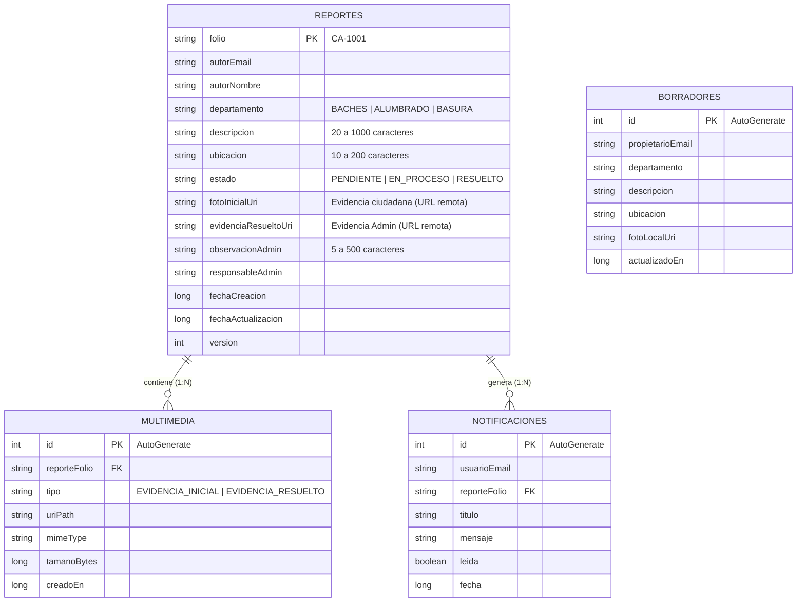
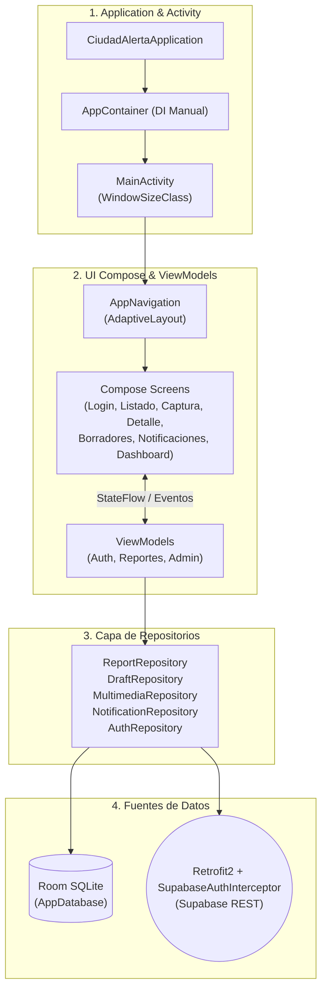
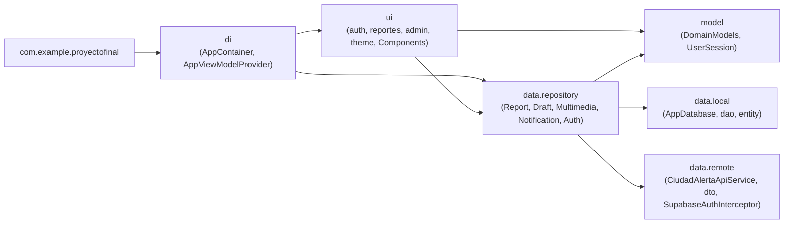
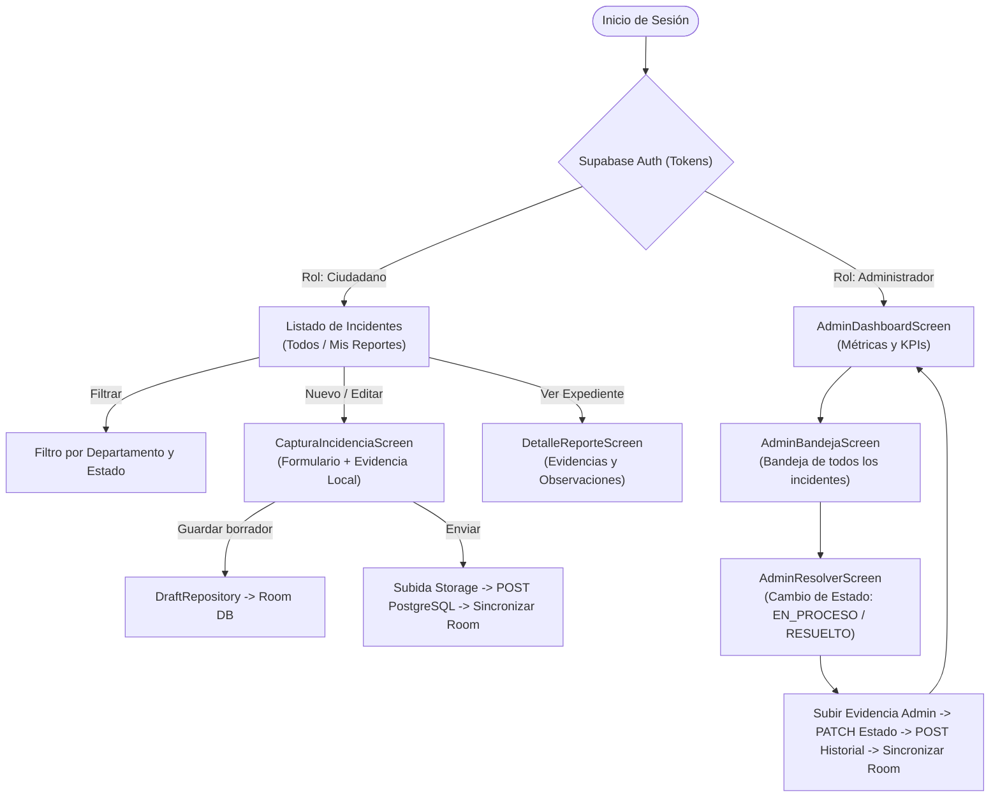

# CIUDAD ALERTA: ARQUITECTURA Y REQUERIMIENTOS

Este documento consolida la arquitectura final del proyecto y sus características técnicas reales. Está diseñado para ser exportado como entregable formal (PDF/DOCX) y refleja la versión en producción conectada a Supabase.

---

## 1. DESCRIPCIÓN GENERAL Y REQUERIMIENTOS
- **Misión:** Aplicación móvil nativa en Android/Kotlin para el reporte de incidencias (baches, alumbrado, basura).
- **Actores:** 
  - **CIUDADANO:** Crea reportes, guarda borradores locales, consulta notificaciones y visualiza estados de reportes comunitarios.
  - **ADMINISTRADOR:** Consulta bandeja de gestión, revisa indicadores en el dashboard, actualiza estados y provee evidencia visual de los casos resueltos.
- **Restricciones Tecnológicas:** Arquitectura nativa estricta utilizando Kotlin, Jetpack Compose, Room (SQLite) y Retrofit. Se prohíbe el uso de frameworks de inyección automatizada (como Hilt/Dagger) y SDKs empaquetados (como Firebase).
- **Backend:** Conexión real a un proyecto **Supabase** (PostgreSQL, Auth, Storage) configurado localmente vía `local.properties`.

## 2. INTERFAZ DE USUARIO (UI) Y NAVEGACIÓN
- **Framework:** Todo el ecosistema visual está desarrollado 100% con **Jetpack Compose**.
- **UX Adaptativa (`WindowSizeClass`):** 
  - **Compact (Teléfonos):** Se emplea un `NavigationBar` en la parte inferior de la pantalla.
  - **Medium / Expanded (Tablets / Desktop):** Se despliega un `NavigationRail` lateral mediante un componente custom `AdaptiveLayout`. El contenido central se limita a un ancho máximo (`max = 600.dp`) para prevenir la distorsión horizontal en pantallas grandes.
- **Enrutamiento (`NavHost`):** La app maneja control de sesión mediante `AppNavigation.kt` y protege sus rutas según el Rol del usuario:
  - Rutas Públicas: `login`, `register`, `recovery`.
  - Rutas Ciudadano: `listado_reportes`, `captura_incidencia`, `borradores`, `notificaciones`, `detalle_reporte`.
  - Rutas Administrador: `admin_dashboard`, `admin_bandeja`, `admin_resolver`, `detalle_reporte`.

## 3. SOPORTE MULTI-IDIOMA (i18n)
La interfaz extrae absolutamente todos sus textos mediante `stringResource()`. Existen traducciones mapeadas de forma nativa en Android:
- `res/values/strings.xml` (Español, por defecto).
- `res/values-en/strings.xml` (Inglés, el cual responde dinámicamente a la configuración del sistema operativo).

## 4. INYECCIÓN DE DEPENDENCIAS (DI)
El proyecto implementa un flujo puramente manual (Vanilla DI), instanciado desde el inicio del ciclo de vida de la aplicación:
`CiudadAlertaApplication -> AppContainer -> MainActivity -> AppNavigation -> AppViewModelProvider.Factory -> ViewModels -> Repositories -> Data Sources (Room / Supabase)`.

## 5. CAPA DE DATOS: LOCAL Y REMOTA

### Base de Datos Local (SQLite - Room)
Base de datos local `ciudad_alerta_db` compuesta por 4 entidades que fungen primariamente como una Caché Offline-First y almacenamiento privado:
1. `ReportEntity`: Sincronización caché de incidentes.
2. `DraftEntity`: Guardado exclusivo y local de borradores ciudadanos.
3. `MultimediaEntity`: Almacén local de metadatos de evidencia.
4. `NotificationEntity`: Historial local de actualizaciones de estado.

### Integración en la Nube (Supabase + Retrofit2)
El consumo de la API se hace mediante Retrofit2 y OkHttp3 contra el endpoint público de Supabase, respetando las convenciones de *snake_case*:
- **Autenticación (GoTrue):** Uso de los endpoints nativos `auth/v1/token`, `auth/v1/signup` y `auth/v1/recover`. La sesión (con tokens y metadata) se persiste localmente en `SharedPreferences`.
- **Base de Datos (PostgREST):** Consumo de `rest/v1/reportes`, `rest/v1/perfiles` y `rest/v1/historial_reportes`. Las operaciones transaccionales y actualizaciones de estado incluyen consultas anidadas.
- **Storage:** Subida programática de binarios (imágenes JPG) usando `RequestBody` directamente desde el repositorio hacia `storage/v1/object/evidencias/`, generando y almacenando URLs públicas persistentes en PostgreSQL.
- **Seguridad:** El componente `SupabaseAuthInterceptor` inyecta dinámicamente la `apikey`, el token Bearer autorizado (`Authorization`) y el encabezado `Prefer: return=representation`.

---

## 6. DIAGRAMAS TÉCNICOS

### 6.1 Diagrama Entidad-Relación (Room SQLite Cache)


### 6.2 Diagrama UML de Componentes


### 6.3 Diagrama UML de Paquetes


### 6.4 Diagrama UML de Despliegue
```mermaid
flowchart LR
    subgraph AndroidNode["Dispositivo Android (API 26 - 36)"]
        APK["CiudadAlerta.apk\n(Kotlin + Jetpack Compose)"]
        RoomDB[("SQLite Cache\n(4 Tablas Room)")]
        Prefs[("SharedPreferences\n(Tokens de Sesión)")]
        APK --> RoomDB
        APK --> Prefs
    end

    subgraph SupabaseCloud["Nube Supabase (PaaS)"]
        Auth["GoTrue Auth API\n(/auth/v1)"]
        Postgres[("PostgreSQL\n(PostgREST /rest/v1)") ]
        Storage[("Storage Bucket\n(/storage/v1/object)") ]
    end

    APK <-->|"HTTPS / JSON\n(Retrofit2 + OkHttp3)"| Auth
    APK <-->|"HTTPS / JSON\n(Filtros Query eq.folio)"| Postgres
    APK <-->|"HTTPS / Multipart\n(Subida Archivos JPG)"| Storage
```

### 6.5 Diagrama de Flujo de Negocio
