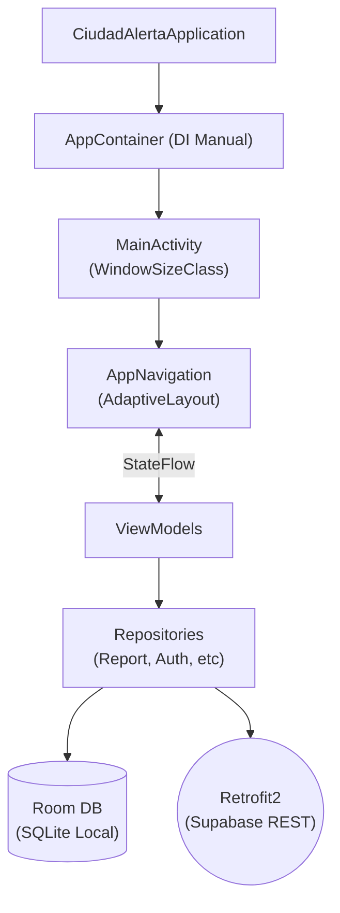

# CIUDAD ALERTA: ARQUITECTURA Y REQUERIMIENTOS

## 1. Documento de requerimientos
- **Misión:** Aplicación móvil nativa en Android/Kotlin para el reporte de incidencias (baches, alumbrado, basura).
- **Actores:** CIUDADANO (crea reportes, guarda borradores) y ADMIN (consulta bandeja, actualiza estados y provee evidencia).
- **Restricciones:** Arquitectura nativa (Kotlin, Jetpack Compose, Room, Retrofit). Prohibido Hilt, Dagger o Firebase.
- **Backend:** Conexión real a un proyecto Supabase (PostgreSQL, Auth, Storage) configurado localmente vía `local.properties`.

## 2. 100% de UI y Navegación Adaptativa
- Todo el proyecto usa **Jetpack Compose**.
- Se implementó `material3-window-size-class`. 
- **UX Adaptativa:** 
  - Teléfonos (Compact): Usan `NavigationBar` inferior.
  - Tablets/Desktop (Expanded/Medium): Usan `NavigationRail` lateral mediante un `AdaptiveLayout` custom wrapper.
- **Rutas (`AppNavigation.kt`):** `login`, `register`, `recovery`, `listado_reportes`, `captura_incidencia`, `borradores`, `notificaciones`, `detalle_reporte`, `admin_dashboard`, `admin_bandeja`, `admin_resolver`.

## 3. Flujo de Inyección de Dependencias
Cadena pura manual ejecutada y auditada:
`CiudadAlertaApplication -> AppContainer -> MainActivity -> AppNavigation -> ViewModelFactory -> ViewModels -> Repositories -> Data Sources (Room/Supabase)`.

## 4. Base de Datos Local (SQLite - Room)
Base de datos `ciudad_alerta_db` compuesta por 4 entidades con operaciones completas (CRUD):
1. `ReportEntity`: Sincronización caché de incidentes.
2. `DraftEntity`: Guardado exclusivo local de borradores ciudadanos.
3. `MultimediaEntity`: Almacén local de URIs de evidencia.
4. `NotificationEntity`: Historial local de actualizaciones.

## 5. Integración con Web APIs y Nube (Supabase)
Conexión real vía Retrofit2 y OkHttp3 contra Supabase:
- **Autenticación:** `auth/v1/token` y `auth/v1/signup`.
- **Base de Datos REST:** `rest/v1/reportes` y `rest/v1/perfiles` manejados de forma nativa por PostgREST.
- **Storage:** Subida de binarios directa desde repositorio a `storage/v1/object/evidencias/` construyendo su URL pública.
- **Seguridad:** Interceptor `SupabaseAuthInterceptor` inyecta dinámicamente `apikey` y `Authorization: Bearer`.

## 6. Soporte Multi-idioma (i18n)
La interfaz principal (`LoginScreen`, `AppNavigation`, `Components`) extrae sus textos clave usando `stringResource()`. Existen traducciones mapeadas en:
- `res/values/strings.xml` (Español, por defecto).
- `res/values-en/strings.xml` (Inglés, responsivo a los ajustes del OS).

## 7. Diagrama UML de Componentes (Actualizado Supabase)

